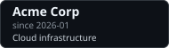
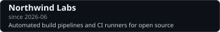
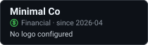
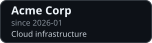
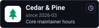
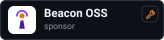

<a href="https://github.com/kettle-dev"></a>

# 💎 Kettle::Sponsors

[![Version][👽versioni]][👽version] [![Ruby Users Forum][✉️ruby-forum-top-img]][✉️ruby-forum] [![GitHub tag (latest SemVer)][⛳️tag-img]][⛳️tag] [![License: MIT][📄license-img]][📄license] [![Total downloads][👽dl-ranki]][👽dl-rank] [![CodeCov Test Coverage][🏀codecovi]][🏀codecov] [![Coveralls Test Coverage][🏀coveralls-img]][🏀coveralls] [![QLTY Test Coverage][🏀qlty-covi]][🏀qlty-cov] [![QLTY Maintainability][🏀qlty-mnti]][🏀qlty-mnt] [![CI Heads][🚎3-hd-wfi]][🚎3-hd-wf] [![CI Runtime Dependencies @ HEAD][🚎12-crh-wfi]][🚎12-crh-wf] [![CI Current][🚎11-c-wfi]][🚎11-c-wf] [![CI Truffle Ruby][🚎9-t-wfi]][🚎9-t-wf] [![CI JRuby][🚎10-j-wfi]][🚎10-j-wf] [![Deps Locked][🚎13-🔒️-wfi]][🚎13-🔒️-wf] [![Deps Unlocked][🚎14-🔓️-wfi]][🚎14-🔓️-wf] [![CI Test Coverage][🚎2-cov-wfi]][🚎2-cov-wf] [![CI Style][🚎5-st-wfi]][🚎5-st-wf] [![Apache SkyWalking Eyes License Compatibility Check][🚎15-🪪-wfi]][🚎15-🪪-wf]

`if ci_badges.map(&:color).detect { it != "green"}` ☝️ [let me know on Discord][✉️discord-invite] or [RubyForum][✉️ruby-forum], as I may have missed the notification.

---

`if ci_badges.map(&:color).all? { it == "green"}` 👇️ send money so I can do more of this. FLOSS maintenance is now my full-time job.

[![OpenCollective Backers][🖇osc-backers-i]][🖇osc-backers] [![OpenCollective Sponsors][🖇osc-sponsors-i]][🖇osc-sponsors] [![Sponsor Me on Github][🖇sponsor-img]][🖇sponsor] [![Liberapay Goal Progress][⛳liberapay-img]][⛳liberapay] [![Donate on PayPal][🖇paypal-img]][🖇paypal] [![Buy me a coffee][🖇buyme-small-img]][🖇buyme] [![Donate at ko-fi.com][🖇kofi-img]][🖇kofi]

<details markdown="1">
 <summary>👣 How will this project approach the September 2025 hostile takeover of RubyGems? 🚑️</summary>

I've summarized my thoughts in [this blog post](https://dev.to/galtzo/hostile-takeover-of-rubygems-my-thoughts-5hlo).

</details>

## 🌻 Synopsis <a href="https://discord.gg/3qme4XHNKN"></a> <a href="https://ruby-toolbox.com"></a>

`Kettle::Sponsors` renders, verifies, and publishes responsive corporate sponsor badges (cards and Shields.io-style small pills) for [kettle-jem](https://github.com/structuredmerge/structuredmerge-ruby/tree/main/gems/kettle-jem) and `kettle-family` managed project READMEs.

### Example Output

Generated from a sample sponsor configuration using `kettle-sponsors` (SVGs hosted in `docs/images/`):

**Responsive sponsor cards** (hybrid desktop/phone layout, embedded logos, contribution kinds, and optional kind-specific animations; switches automatically to `docs/images/phone/` below `600px`):

<a href="https://acme.example"><picture><source media="(max-width: 600px)" srcset="docs/images/phone/acme-corp.svg"></picture></a> <a href="https://northwind.example"><picture><source media="(max-width: 600px)" srcset="docs/images/phone/northwind-labs.svg"></picture></a> <picture><source media="(max-width: 600px)" srcset="docs/images/phone/cedar-pine.svg"></picture> <a href="https://beacon.example"><picture><source media="(max-width: 600px)" srcset="docs/images/phone/beacon-oss.svg"></picture></a>

**Small badge parade** (single-line Shields.io-style offline SVGs for the top of a README):

<a href="https://acme.example"></a> <a href="https://northwind.example"></a>  <a href="https://beacon.example"></a>

Key features:

- **Embedded sponsor logos (offline or remote fetch)** — Base64-embeds local files (`.svg`, `.png`, `.jpg`, `.webp`) or `data:` URIs directly inside each SVG so logos render reliably inside GitHub README `` tags, with opt-in cached remote HTTP(S) fetching (`fetch_logos: true` / `--fetch-logos`).
- **Financial & in-kind sponsorship kinds** — Supports `financial` (default), `compute`, `time` (`Engineer time`), and `services` with crisp inline vector iconography.
- **Hybrid responsive cards** — Desktop badges display a left logo tile plus inline icon and label (`Financial · since 2026-01`); compact mobile (`phone/`) badges switch to a top-right icon-only pill and truncate long descriptions at 40 characters.
- **Shields.io-style small badges** — Renders offline SVG pills matching all five canonical Shields.io styles (`flat`, `flat-square`, `plastic`, `for-the-badge`, `social`) for top-of-README badge parades.
- **Configurable theme, colors & subsetted fonts** — Customize background, border, text, muted, description, logo tile backdrop, kind accents, metallic coin palette (`gold` / `silver`), CSS font stack (defaulting to `pboling/pboling`'s stack), and optional `pyftsubset`-subsetted embedded `@font-face` fonts.
- **Kind-specific CSS animations** — Optional `hover` or `always` animations (`financial` 3D metallic coins, `compute` ECG heartbeat pulse, `time` glowing keyboard, `services` interlocking gears), honoring `prefers-reduced-motion`.
- **Central hosting by default, local opt-in** — Serves from `https://logos.galtzo.com/assets/images/sponsors` by default, or renders locally into `docs/assets/images/sponsors` for `badge: local` sponsors.
- **Checksum-gated & date-windowed** — Tracks active sponsors and theme settings via `.checksum`, supports inclusive `since`/`until` windows, publishes deterministically to central registries (`kettle-sponsors publish`), verifies URLs on demand (`--verify`), and integrates as a `kettle-jem` plugin.

## 💡 Info you can shake a stick at

| Tokens to Remember | [![Gem name][⛳️name-img]][⛳️gem-name] [![Gem namespace][⛳️namespace-img]][⛳️gem-namespace] |
|-------------------------|---------------------------------------------------------------------------------------------------------------------------------------------------------------------------------------------------------------------------------------------------------------------------------------------------------------------------------------------------------------------|
| Works with JRuby | [![JRuby 10.0 Compat][💎jruby-10.0i]][🚎jruby-10.0-wf] [![JRuby current Compat][💎jruby-c-i]][🚎10-j-wf] [![JRuby HEAD Compat][💎jruby-headi]][🚎3-hd-wf]|
| Works with Truffle Ruby | [![Truffle Ruby 24.2 Compat][💎truby-24.2i]][🚎truby-24.2-wf] [![Truffle Ruby 25.0 Compat][💎truby-25.0i]][🚎truby-25.0-wf] [![Truffle Ruby 33.0 Compat][💎truby-33.0i]][🚎truby-33.0-wf] [![Truffle Ruby current Compat][💎truby-c-i]][🚎9-t-wf]|
| Works with MRI Ruby 4 | [![Ruby current Compat][💎ruby-c-i]][🚎11-c-wf] [![Ruby HEAD Compat][💎ruby-headi]][🚎3-hd-wf]|
| Works with MRI Ruby 3 | [![Ruby 3.2 Compat][💎ruby-3.2i]][🚎ruby-3.2-wf] [![Ruby 3.3 Compat][💎ruby-3.3i]][🚎ruby-3.3-wf] [![Ruby 3.4 Compat][💎ruby-3.4i]][🚎ruby-3.4-wf]|
| Support & Community | [![Join Me on Daily.dev's RubyFriends][✉️ruby-friends-img]][✉️ruby-friends] [![Get help from RubyForum][✉️ruby-forum-img]][✉️ruby-forum] [![Live Chat on Discord][✉️discord-invite-img-ftb]][✉️discord-invite] [![Get help from me on Upwork][👨🏼‍🏫expsup-upwork-img]][👨🏼‍🏫expsup-upwork] [![Get help from me on Codementor][👨🏼‍🏫expsup-codementor-img]][👨🏼‍🏫expsup-codementor] |
| Source | [![Source on GitLab.com][📜src-gl-img]][📜src-gl] [![Source on CodeBerg.org][📜src-cb-img]][📜src-cb] [![Source on GitHub.com][📜src-gh-img]][📜src-gh] [![The best SHA: dQw4w9WgXcQ!][🧮kloc-img]][🧮kloc] |
| Documentation | [![Current release on RubyDoc.info][📜docs-cr-rd-img]][🚎yard-current] [![YARD on Galtzo.com][📜docs-head-rd-img]][🚎yard-head] [![Maintainer Blog][🚂maint-blog-img]][🚂maint-blog] [![GitLab Wiki][📜gl-wiki-img]][📜gl-wiki] [![GitHub Wiki][📜gh-wiki-img]][📜gh-wiki] |
| Compliance | [![License: MIT][📄license-img]][📄license] [![Apache license compatibility: Category A][📄license-compat-img]][📄license-compat] [![📄ilo-declaration-img]][📄ilo-declaration] [![Security Policy][🔐security-img]][🔐security] [![Contributor Covenant 2.1][🪇conduct-img]][🪇conduct] [![SemVer 2.0.0][📌semver-img]][📌semver] |
| Style | [![Enforced Code Style Linter][💎rlts-img]][💎rlts] [![Keep-A-Changelog 1.0.0][📗keep-changelog-img]][📗keep-changelog] [![Gitmoji Commits][📌gitmoji-img]][📌gitmoji] [![Compatibility appraised by: appraisal2][💎appraisal2-img]][💎appraisal2] |
| Maintainer 🎖️ | [![Follow Me on LinkedIn][💖🖇linkedin-img]][💖🖇linkedin] [![Follow Me on Ruby.Social][💖🐘ruby-mast-img]][💖🐘ruby-mast] [![Follow Me on Bluesky][💖🦋bluesky-img]][💖🦋bluesky] [![Contact Maintainer][🚂maint-contact-img]][🚂maint-contact] [![My technical writing][💖💁🏼‍♂️devto-img]][💖💁🏼‍♂️devto] |
| `...` 💖 | [![Find Me on WellFound:][💖✌️wellfound-img]][💖✌️wellfound] [![Find Me on CrunchBase][💖💲crunchbase-img]][💖💲crunchbase] [![My LinkTree][💖🌳linktree-img]][💖🌳linktree] [![More About Me][💖💁🏼‍♂️aboutme-img]][💖💁🏼‍♂️aboutme] [🧊][💖🧊berg] [🐙][💖🐙hub] [🛖][💖🛖hut] [🧪][💖🧪lab] |

### Compatibility

The gem's declared runtime compatibility floor is MRI Ruby 3.2.0+, with concordant releases of JRuby and TruffleRuby.
CI workflows and Appraisals are generated for MRI Ruby 3.2.0+.
The current MRI CI lane runs on Linux and macOS.
The test floor is configured by `ruby.test_minimum` in `.kettle-jem.yml`.
When it is higher than the runtime floor, older runtime-compatible Rubies are
not covered by the generated CI or Appraisal matrix.

<a href="https://github.com/kettle-dev"></a>

The _amazing_ test matrix is powered by the kettle-dev stack.

<details markdown="1">
<summary>How kettle-dev manages complexity in tests</summary>

| Gem | Source | Role | Total downloads |
|-----|--------|------|---------------------|
| [appraisal2](https://clickgems.clickhouse.com/dashboard/appraisal2) | [GitHub](https://github.com/appraisal-rb/appraisal2) | multi-dependency Appraisal matrix generation | [](https://clickgems.clickhouse.com/dashboard/appraisal2) |
| [appraisal2-rubocop](https://clickgems.clickhouse.com/dashboard/appraisal2-rubocop) | [GitHub](https://github.com/appraisal-rb/appraisal2-rubocop) | RuboCop Appraisal generator integration | [](https://clickgems.clickhouse.com/dashboard/appraisal2-rubocop) |
| [kettle-dev](https://clickgems.clickhouse.com/dashboard/kettle-dev) | [GitHub](https://github.com/kettle-dev/kettle-dev) | development, release, and CI workflow tooling | [](https://clickgems.clickhouse.com/dashboard/kettle-dev) |
| [kettle-jem](https://clickgems.clickhouse.com/dashboard/kettle-jem) | [GitHub](https://github.com/kettle-dev/kettle-jem) | Appraisals & CI workflow templates | [](https://clickgems.clickhouse.com/dashboard/kettle-jem) |
| [kettle-soup-cover](https://clickgems.clickhouse.com/dashboard/kettle-soup-cover) | [GitHub](https://github.com/kettle-dev/kettle-soup-cover) | SimpleCov coverage policy and reporting | [](https://clickgems.clickhouse.com/dashboard/kettle-soup-cover) |
| [kettle-test](https://clickgems.clickhouse.com/dashboard/kettle-test) | [GitHub](https://github.com/kettle-dev/kettle-test) | standard test runner and coverage harness | [](https://clickgems.clickhouse.com/dashboard/kettle-test) |
| [rubocop-lts](https://clickgems.clickhouse.com/dashboard/rubocop-lts) | [GitHub](https://github.com/rubocop-lts/rubocop-lts) | Ruby-version-aware linting | [](https://clickgems.clickhouse.com/dashboard/rubocop-lts) |
| [turbo_tests2](https://clickgems.clickhouse.com/dashboard/turbo_tests2) | [GitHub](https://github.com/galtzo-floss/turbo_tests2) | parallel test execution | [](https://clickgems.clickhouse.com/dashboard/turbo_tests2) |

</details>

### Federated DVCS

<details markdown="1">
 <summary>Find this repo on federated forges (Coming soon!)</summary>

| Federated [DVCS][💎d-in-dvcs] Repository | Status | Issues | PRs | Wiki | CI |
|-------------------------------------------------|-------------------------------------------|-------------------|------------------|-----------------|----------------|
| 🧪 [kettle-dev/kettle-sponsors on GitLab][📜src-gl] | The Truth | [💚][🤝gl-issues] | [💚][🤝gl-pulls] | [💚][📜gl-wiki] | 🐭 Tiny Matrix |
| 🧊 [kettle-dev/kettle-sponsors on CodeBerg][📜src-cb] | An Ethical Mirror ([Donate][🤝cb-donate]) | [💚][🤝cb-issues] | [💚][🤝cb-pulls] | ➖ | ⭕️ No Matrix |
| 🐙 [kettle-dev/kettle-sponsors on GitHub][📜src-gh] | Another Mirror | [💚][🤝gh-issues] | [💚][🤝gh-pulls] | [💚][📜gh-wiki] | 💯 Full Matrix |

</details>

### Enterprise Support

For enterprise support from the maintainer, use [Upwork][👨🏼‍🏫expsup-upwork] or [CodeMentor][👨🏼‍🏫expsup-codementor].

Other support channels:

- [![Ruby Users Forum][✉️ruby-forum-img]][✉️ruby-forum]
- [![Live Chat on Discord][✉️discord-invite-img-ftb]][✉️discord-invite]

## ✨ Installation

Install the gem and add to the application's Gemfile by executing:

```console
bundle add kettle-sponsors
```

If bundler is not being used to manage dependencies, install the gem by executing:

```console
gem install kettle-sponsors
```

## ⚙️ Configuration

### Enabling the `kettle-jem` Plugin

Add `kettle-sponsors` to the `plugins:` list in `.structuredmerge/kettle-jem.yml`:

```yaml
plugins:
  - kettle-sponsors
```

During bundled templating, `kettle-jem` calls `Kettle::Sponsors.register_kettle_jem_plugin(registrar)`, registering an `after_phase(:remaining_files)` hook. For any sponsor configured with `badge: local`, the plugin renders its desktop, phone, and shield SVGs into `docs/assets/images/sponsors` using any configured `readme.sponsor_theme` and records the generated files with `kettle-jem`. Central badges (`badge: central`, the default) require no local files because they are referenced by URL.

### Defining Sponsors

Define sponsors under `readme.corporate_sponsors` (and optional theme settings under `readme.sponsor_theme`) in `.structuredmerge/kettle-jem.yml`:

```yaml
readme:
  sponsor_theme:
    animate: always
    coin_metal: gold
  corporate_sponsors:
    - name: Acme Corp
      target_href: https://acme.example
      logo: docs/images/logos/acme-corp.svg
      since: 2026-01-15
      description: Cloud infrastructure
      kind: financial
      badge: local
    - name: Northwind Labs
      target_href: https://northwind.example
      logo: docs/images/logos/northwind-labs.svg
      since: 2026-06-01
      description: Automated build pipelines and CI runners for open source
      kind: compute
      badge: local
    - name: Cedar & Pine
      logo: docs/images/logos/cedar-pine.svg
      since: 2026-03-01
      description: Core maintainer hours
      kind: time
      badge: local
    - name: Beacon OSS
      target_href: https://beacon.example
      logo: docs/images/logos/beacon-oss.svg
      kind: services
      badge: local
```

#### Sponsor Entry Fields

| Field | Required | Default | Description |
|-------|----------|---------|-------------|
| `name` | Yes | — | Sponsor display name (non-empty). Normalized to a lowercase hyphenated slug; duplicate slugs raise `Kettle::Sponsors::Error`. |
| `target_href` (alias: `url`) | No | `""` | Destination link URL (`http://` or `https://`). When omitted, markup renders `<picture>` / `` without an `<a>` wrapper. |
| `logo` (aliases: `image_src`, `img_src`) | No | `nil` | Local image path (`.svg`, `.png`, `.jpg`, `.webp`), `data:image/...` URI, or `http(s)://` URL (fetched only when `fetch_logos: true`). Embedded as a `data:` URI inside the SVG. |
| `kind` | No | `"financial"` | Sponsorship type: `"financial"` (`Financial`), `"compute"` (`Compute`), `"time"` (`Engineer time`), or `"services"` (`Services`). Controls the icon, label, accent color, and animation motif. |
| `since` | No | `nil` | First active date (inclusive, ISO 8601 `YYYY-MM-DD`). Displayed as `since YYYY-MM` (falls back to `sponsor` when omitted). |
| `until` | No | `nil` | Last active date (inclusive, ISO 8601 `YYYY-MM-DD`). Expired sponsors are excluded from markup, checksums, and verification, and their rendered SVGs are pruned. |
| `description` | No | `""` | Short tagline rendered on the third line (truncated to 40 characters + `…` on `:phone`) and appended to the `alt` attribute. |
| `label` | No | kind short label | Optional custom left-side label for Shields.io-style small badges (defaults to `sponsor`, `compute`, `eng time`, or `services`). |
| `color` | No | kind accent | Optional per-sponsor right-side color override for Shields.io-style small badges. |
| `logo_background` | No | theme `logo_background` | Optional per-sponsor logo tile backdrop color (e.g., `"#ffffff"` or `"transparent"`). |
| `badge` | No | `"central"` | Hosting mode: `"central"` serves SVGs from `Kettle::Sponsors::CENTRAL_BASE`; `"local"` renders SVGs into `Kettle::Sponsors::LOCAL_DIR`. |

#### Badge Variations by Kind & Field

| Variation | Effect on Rendered Badge | Rendered Desktop SVG |
|-----------|--------------------------|----------------------|
| `kind: financial` + logo + `since` + `description` | 3-line card with embedded logo, Financial icon, and 3D gold coin stack motif |  |
| `kind: compute` + logo + long `description` (`> 40` chars) | Auto-widens on desktop with ECG heartbeat sparkline; truncates with `…` on `:phone` |  |
| `kind: time` + logo + `&` in name, no `target_href` | XML-escaped name, glowing keyboard motif, rendered without an `<a>` wrapper |  |
| `kind: services` + logo, no `since` or `description` | Compact 2-line card (`52px` tall) with `"sponsor"` subtitle and interlocking gears |  |
| No `logo` configured (`animate: none`) | Clean text-only fallback with no empty left padding |  |

### Theme, Colors, Fonts & Animations

Configure global visual defaults under `readme.sponsor_theme` (or top-level `sponsor_theme:` / `theme:` in standalone registries):

```yaml
readme:
  sponsor_theme:
    background: "#14211f"
    border: "#25403c"
    text: "#f4efe4"
    muted: "#8fa6a1"
    description: "#c8d6d3"
    logo_background: "#ffffff"
    coin_metal: silver
    label_color: "#555555"
    font: "system-ui,-apple-system,'Segoe UI',Roboto,sans-serif"
    font_file: assets/fonts/Inter-Regular.ttf
    animate: hover
    shield_style: flat
    fetch_logos: false
    logo_cache: tmp/sponsor-logos
    accents:
      financial: "#3fb950"
      compute: "#58a6ff"
      time: "#d2a8ff"
      services: "#f0883e"
```

Example custom theme (`sm-urb-design` dark-teal palette with `coin_metal: silver`):


#### Theme Options

| Option | Default | Description |
|--------|---------|-------------|
| `background` | `"#0d1117"` | Card background fill color. |
| `border` | `"#30363d"` | Card border stroke color. |
| `text` | `"#f0f6fc"` | Sponsor display name text color. |
| `muted` | `"#8b949e"` | Subtitle / metadata (`kind · since`) text color. |
| `description` | `"#c9d1d9"` | Description line text color. |
| `logo_background` | `"#ffffff"` | Rounded tile backdrop behind sponsor logos so dark wordmarks stay legible on dark cards; set to `"transparent"` or `"none"` to disable. |
| `accents` | `{financial: "#3fb950", compute: "#58a6ff", time: "#d2a8ff", services: "#f0883e"}` | Per-kind icon, animation, and default Shields right-side accent colors. |
| `coin_metal` | `"gold"` | Metallic 3D coin palette for `financial` animations: `"gold"` or `"silver"`. |
| `label_color` | `"#555555"` | Left-side label fill color for Shields.io-style small badges. |
| `color` | `nil` | Global right-side color override for Shields.io-style small badges (defaults to each sponsor's kind accent). |
| `font` | `"system-ui,-apple-system,'Segoe UI',Roboto,sans-serif"` | CSS `font-family` stack (matches `pboling/pboling`'s SVG font stack). |
| `font_file` | `nil` | Optional path to a `.ttf`, `.otf`, `.woff`, or `.woff2` file. When set, `FontSubsetter` invokes `pyftsubset` (from `fonttools`, if on `PATH`) to subset the font to only the unique characters used in each SVG and embeds `@font-face` as a base64 `data:` URI (falling back to embedding the full source font if `pyftsubset` is unavailable). |
| `font_family` | sanitized `font_file` basename | Custom `@font-face` family name when `font_file` is set. |
| `animate` | `"none"` | Kind-specific animation mode: `"none"`, `"hover"` (triggers on `svg:hover` — works for inline SVGs / `<object>` web embeds), or `"always"` (runs continuously — works inside GitHub README `` tags, where browsers disable `:hover`). All animations honor `prefers-reduced-motion: reduce`. |
| `shield_style` | `"flat"` | Small badge style matching Shields.io: `"flat"`, `"flat-square"`, `"plastic"`, `"for-the-badge"`, or `"social"`. |
| `fetch_logos` | `false` | Offline by default (local files and `data:` URIs only). Set `true` (or pass `--fetch-logos`) to download and embed remote `http(s)://` logos. |
| `logo_cache` | `nil` | Optional directory used to cache downloaded remote logos across runs. |

#### Supported Config File Formats

`Kettle::Sponsors::Config.load(path)` accepts both `kettle-jem` configs and standalone registry YAML files, looking up the sponsor array in the following order:

1. `sponsors` — standalone central registry format (written by `kettle-sponsors publish`)
2. `readme.corporate_sponsors` — standard `.structuredmerge/kettle-jem.yml` format
3. `sponsorships.corporate` — alternate nested format
4. `corporate_sponsors` — top-level shorthand

`Kettle::Sponsors::Config.load_theme(path)` reads `readme.sponsor_theme`, `sponsor_theme`, or `theme`. If `path` does not exist, `Config.load` returns `[]` and `Config.load_theme` returns default `Theme.new`.

#### Defaults & Constants

| Constant | Default Value | Purpose |
|----------|---------------|---------|
| `Kettle::Sponsors::CONFIG_PATH` | `".structuredmerge/kettle-jem.yml"` | Default config path for the CLI and `kettle-jem` plugin. |
| `Kettle::Sponsors::LOCAL_DIR` | `"docs/assets/images/sponsors"` | Default output directory for locally rendered desktop, `phone/`, and `shield/` SVGs plus `.checksum`. |
| `Kettle::Sponsors::CENTRAL_BASE` | `"https://logos.galtzo.com/assets/images/sponsors"` | Base URL for centrally hosted desktop, `phone/`, and `shield/` SVGs. |
| `Kettle::Sponsors::Checksum::FILENAME` | `".checksum"` | File written inside the output directory storing the active-sponsor and theme SHA-256 digest. |

## 🔧 Basic Usage

### Command-Line Interface

The `kettle-sponsors` executable manages rendering, freshness checks, URL verification, and central registry publishing.

#### Render Badges

Render desktop (`<out>/<slug>.svg`), mobile (`<out>/phone/<slug>.svg`), and Shields-style small (`<out>/shield/<slug>.svg`) SVGs for all active sponsors in the config file:

```console
bundle exec kettle-sponsors
```

Customize options from the CLI (overriding any values in the config file):

```console
bundle exec kettle-sponsors --config sponsors.yml --out docs/assets/images/sponsors --fetch-logos --animate always --shield-style for-the-badge --force
```

Stale SVGs from removed or expired sponsors are deleted automatically so the output directory stays in sync with active sponsors.

#### Check Freshness

Verify whether rendered badges match the current active sponsors and theme (useful in CI):

```console
bundle exec kettle-sponsors --check
```

Exits `0` (`sponsors unchanged`) when current, or `1` (`sponsors changed`) when stale or missing.

#### Verify Central Badge URLs

Perform an opt-in HTTP `HEAD` check against the desktop and phone SVG URLs for every active central sponsor:

```console
bundle exec kettle-sponsors --verify
```

Prints `ok      <url>` or `MISSING <url>` for each badge URL. Exits `0` if all are reachable, or `1` if any are missing or unreachable.

#### Publish to a Central Registry

Merge sponsors from a project or family config into a central registry YAML file (such as the input registry for `logos.galtzo.com`):

```console
bundle exec kettle-sponsors publish --from .structuredmerge/kettle-jem.yml --registry path/to/sponsors.yml
```

Entries are merged by slug (incoming wins), registry-only entries are preserved, output is sorted by slug, and `nil`/blank fields plus default `badge: central` / `kind: financial` are omitted. Repeated runs with no changes are a no-op (`registry unchanged`).

#### CLI Options & Exit Codes

```text
Usage: kettle-sponsors [options]
        --config PATH                kettle-jem.yml or registry (default .structuredmerge/kettle-jem.yml)
        --out DIR                    output directory (default docs/assets/images/sponsors)
        --check                      exit 1 if badges are stale, 0 if current
        --verify                     HEAD-check central badge URLs (network)
        --from PATH                  publish: source config with sponsors
        --registry PATH              publish: registry file to merge into
        --force                      render even when unchanged
        --fetch-logos                fetch remote http(s) logo URLs and embed them
        --animate MODE               animation mode: none, hover, always
        --shield-style STYLE         small badge style: flat, flat-square, plastic, for-the-badge, social
        --font STACK                 CSS font-family stack
        --font-file PATH             font file to subset via pyftsubset and embed
        --coin-metal METAL           financial coin style: gold, silver
```

- Exit `0`: Success (rendered, up to date, all verified URLs reachable, or registry published).
- Exit `1`: Badges are stale (`--check`) or one or more central URLs failed verification (`--verify`).
- Exit `2`: Configuration error (`Kettle::Sponsors::Error`) or invalid CLI options.

### Ruby API

#### Load Sponsors & Theme and Build README Markup

```ruby
require "kettle/sponsors"

loaded   = Kettle::Sponsors::Config.load_all(".structuredmerge/kettle-jem.yml")
sponsors = loaded[:sponsors]
theme    = loaded[:theme]

# Responsive <a href><picture>...</picture></a> card grid for active sponsors
cards_html = Kettle::Sponsors::Markup.badges(sponsors, width: "25%", today: Date.today)

# Single-line Shields.io-style badge parade for top-of-README
parade_html = Kettle::Sponsors::Markup.shields(sponsors, today: Date.today)
```

#### Hybrid Desktop vs. Phone Variants

`Kettle::Sponsors::BadgeRenderer.svg` uses a hybrid layout: `:desktop` shows the inline kind icon + label on the metadata line and optional right-side animation motif, while `:phone` switches to a compact card with a top-right icon-only corner pill and 40-character description truncation:

| Sponsor | `:desktop` (inline icon & label + motif) | `:phone` (compact + icon corner pill) |
|---------|------------------------------------------|---------------------------------------|
| **Acme Corp** (`financial`) |  |  |
| **Northwind Labs** (`compute`) |  |  |
| **Cedar & Pine** (`time`) |  |  |
| **Beacon OSS** (`services`) |  |  |

#### Small Badge Parade — All 5 Shields.io Styles

`Kettle::Sponsors::ShieldRenderer.svg` (or `BadgeRenderer.svg(sponsor, variant: :shield)`) renders all five canonical Shields.io styles offline with embedded logos:

| `shield_style` | Rendered SVG |
|----------------|--------------|
| `flat` (default, `20px`, rounded + gradient) |  |
| `flat-square` (`20px`, crisp square edges) |  |
| `plastic` (`18px`, glossy highlight) |  |
| `for-the-badge` (`28px`, bold uppercase) |  |
| `social` (`20px`, light pill + speech callout) |  |

#### Render SVGs Programmatically

```ruby
theme = Kettle::Sponsors::Theme.new(
  background: "#14211f",
  border: "#25403c",
  text: "#f4efe4",
  coin_metal: "silver",
  animate: "hover",
  shield_style: "for-the-badge",
  fetch_logos: false
)

# Render individual SVG strings (:desktop, :phone, or :shield)
desktop_svg = Kettle::Sponsors::BadgeRenderer.svg(sponsors.first, variant: :desktop, theme: theme, base_dir: Dir.pwd)
phone_svg   = Kettle::Sponsors::BadgeRenderer.svg(sponsors.first, variant: :phone, theme: theme, base_dir: Dir.pwd)
shield_svg  = Kettle::Sponsors::ShieldRenderer.svg(sponsors.first, style: "flat-square", theme: theme, base_dir: Dir.pwd)

# Render active sponsors to disk (desktop, phone/, and shield/; empty array if unchanged)
written = Kettle::Sponsors::Renderer.render(sponsors, out: Kettle::Sponsors::LOCAL_DIR, theme: theme, base_dir: Dir.pwd)

# Check if output directory is out of date
stale = Kettle::Sponsors::Renderer.stale?(sponsors, out: Kettle::Sponsors::LOCAL_DIR, theme: theme)
```

#### Publish and Verify Programmatically

```ruby
# Merge sponsors into a central registry file (returns true if the file changed)
changed = Kettle::Sponsors::Registry.publish(
  from: ".structuredmerge/kettle-jem.yml",
  registry: "sponsors.yml"
)

# HEAD-check active central badge URLs (returns Hash{String => Boolean})
results = Kettle::Sponsors::Verifier.verify(sponsors)
```

## 🦷 FLOSS Funding

While kettle-dev tools are free software and will always be, the project would benefit immensely from some funding.
Raising a monthly budget of... "dollars" would make the project more sustainable.

We welcome both individual and corporate sponsors! We also offer a
wide array of funding channels to account for your preferences.
Currently, [Open Collective][🖇osc] is our preferred funding platform.

### Corporate Sponsorship

**If you're working in a company that's making significant use of kettle-dev tools we'd
appreciate it if you suggest to your company to become a kettle-dev sponsor.**

### Individual Support

You can support the development of kettle-dev tools via
[GitHub Sponsors][🖇sponsor],
[Liberapay][⛳liberapay],
[Open Collective][🖇osc],
and [PayPal][🖇paypal].

### Open Collective for Individuals

Support us with a monthly donation and help us continue our activities. [[Become a backer](https://opencollective.com/kettle-dev#backer)]

NOTE: [kettle-readme-backers][kettle-readme-backers] updates this list every day, automatically.

<!-- OPENCOLLECTIVE-INDIVIDUALS:START -->
No backers yet. Be the first!
<!-- OPENCOLLECTIVE-INDIVIDUALS:END -->

### Open Collective for Organizations

Become a sponsor and get your logo on our README on GitHub with a link to your site. [[Become a sponsor](https://opencollective.com/kettle-dev#sponsor)]

NOTE: [kettle-readme-backers][kettle-readme-backers] updates this list every day, automatically.

<!-- OPENCOLLECTIVE-ORGANIZATIONS:START -->
No sponsors yet. Be the first!
<!-- OPENCOLLECTIVE-ORGANIZATIONS:END -->

[kettle-readme-backers]: https://github.com/kettle-dev/kettle-sponsors/blob/main/bin/kettle-readme-backers

### Another way to support open-source

I’m driven by a passion to foster a thriving open-source community – a space where people can tackle complex problems, no matter how small. Revitalizing libraries that have fallen into disrepair, and building new libraries focused on solving real-world challenges, are my passions. I was recently affected by layoffs, and the tech jobs market is unwelcoming. I’m reaching out here because your support would significantly aid my efforts to provide for my family, and my farm (11 🐔 chickens, 2 🐶 dogs, 3 🐰 rabbits, 8 🐈‍ cats).

If you work at a company that uses my work, please encourage them to support me as a corporate sponsor. My work on gems you use might show up in `bundle fund`.

I’m developing a new library, [floss_funding][🖇floss-funding-gem], designed to empower open-source developers like myself to get paid for the work we do, in a sustainable way. Please give it a look.

**[Floss-Funding.dev][🖇floss-funding.dev]: 👉️ No network calls. 👉️ No tracking. 👉️ No oversight. 👉️ Minimal crypto hashing. 💡 Easily disabled nags**

[![OpenCollective Backers][🖇osc-backers-i]][🖇osc-backers] [![OpenCollective Sponsors][🖇osc-sponsors-i]][🖇osc-sponsors] [![Sponsor Me on Github][🖇sponsor-img]][🖇sponsor] [![Liberapay Goal Progress][⛳liberapay-img]][⛳liberapay] [![Donate on PayPal][🖇paypal-img]][🖇paypal] [![Buy me a coffee][🖇buyme-small-img]][🖇buyme] [![Donate to my FLOSS efforts at ko-fi.com][🖇kofi-img]][🖇kofi]

## 🔐 Security

See [SECURITY.md][🔐security].

## 🤝 Contributing

If you need some ideas of where to help, you could work on adding more code coverage,
check [issues][🤝gh-issues] or [PRs][🤝gh-pulls], or use the gem and think about how it could be better.

We [![Keep A Changelog][📗keep-changelog-img]][📗keep-changelog] so if you make changes, remember to update it.

See [CONTRIBUTING.md][🤝contributing] for more detailed instructions.

### 🚀 Release Instructions

See [CONTRIBUTING.md][🤝contributing].

### Code Coverage

<details markdown="1">
<summary>Coverage service badges</summary>

[![Coverage Graph][🏀codecov-g]][🏀codecov]

[![Coveralls Test Coverage][🏀coveralls-img]][🏀coveralls]

[![QLTY Test Coverage][🏀qlty-covi]][🏀qlty-cov]

</details>

### 🪇 Code of Conduct

Everyone interacting with this project's codebases, issue trackers,
chat rooms and mailing lists agrees to follow the [![Contributor Covenant 2.1][🪇conduct-img]][🪇conduct].

## 🌈 Contributors

[![Contributors][🖐contributors-img]][🖐contributors]

Made with [contributors-img][🖐contrib-rocks].

Also see GitLab Contributors: [https://gitlab.com/kettle-dev/kettle-sponsors/-/graphs/main][🚎contributors-gl]

## 📌 Versioning

This library follows [![Semantic Versioning 2.0.0][📌semver-img]][📌semver] for its public API where practical.
For most applications, prefer the [Pessimistic Version Constraint][📌pvc] with two digits of precision.

For example:

```ruby
spec.add_dependency("kettle-sponsors", "~> 0.0")
```

<details markdown="1">
<summary>📌 Is "Platform Support" part of the public API? More details inside.</summary>

Dropping support for a platform can be a breaking change for affected users.
If a release changes supported platforms, it should be called out clearly in the changelog and versioned with that impact in mind.

To get a better understanding of how SemVer is intended to work over a project's lifetime,
read this article from the creator of SemVer:

- ["Major Version Numbers are Not Sacred"][📌major-versions-not-sacred]

</details>

See [CHANGELOG.md][📌changelog] for a list of releases.

## 📄 License

The gem is available as open source under the terms of
the [MIT](https://github.com/kettle-dev/kettle-sponsors/blob/main/MIT.md) [![License: MIT][📄license-img]][📄license-ref].

### © Copyright

See [LICENSE.md][📄license] for the official copyright notice.

<details markdown="1">
<summary>Copyright holders</summary>

- Copyright (c) 2026 Peter H. Boling

</details>

## 🤑 A request for help

Maintainers have teeth and need to pay their dentists.
After getting laid off in an RIF in March, and encountering difficulty finding a new one,
I began spending most of my time building open source tools.
I'm hoping to be able to pay for my kids' health insurance this month,
so if you value the work I am doing, I need your support.
Please consider sponsoring me or the project.

To join the community or get help, use the RubyForum or Discord.

[![Ruby Users Forum][✉️ruby-forum-img]][✉️ruby-forum]
[![Live Chat on Discord][✉️discord-invite-img-ftb]][✉️discord-invite]

To say "thanks!" ☝️ Join the community or 👇️ send money.

[![Sponsor kettle-dev/kettle-sponsors on Open Source Collective][🖇osc-all-bottom-img]][🖇osc] 💌 [![Sponsor me on GitHub Sponsors][🖇sponsor-bottom-img]][🖇sponsor] 💌 [![Sponsor me on Liberapay][⛳liberapay-bottom-img]][⛳liberapay] 💌 [![Donate on PayPal][🖇paypal-bottom-img]][🖇paypal]

### Please give the project a star ⭐ ♥.

Many parts of this project are actively managed by a [kettle-jem](https://github.com/structuredmerge/structuredmerge-ruby/tree/main/gems/kettle-jem) smart template utilizing [StructuredMerge.org](https://structuredmerge.org) merge contracts.

Thanks for RTFM. ☺️

[⛳liberapay-img]: https://img.shields.io/liberapay/goal/pboling.svg?logo=liberapay&color=a51611&style=flat
[⛳liberapay-bottom-img]: https://img.shields.io/liberapay/goal/pboling.svg?style=for-the-badge&logo=liberapay&color=a51611
[⛳liberapay]: https://liberapay.com/pboling/donate
[🖇osc-all-img]: https://img.shields.io/opencollective/all/kettle-dev
[🖇osc-sponsors-img]: https://img.shields.io/opencollective/sponsors/kettle-dev
[🖇osc-backers-img]: https://img.shields.io/opencollective/backers/kettle-dev
[🖇osc-backers]: https://opencollective.com/kettle-dev#backer
[🖇osc-backers-i]: https://opencollective.com/kettle-dev/backers/badge.svg?style=flat
[🖇osc-sponsors]: https://opencollective.com/kettle-dev#sponsor
[🖇osc-sponsors-i]: https://opencollective.com/kettle-dev/sponsors/badge.svg?style=flat
[🖇osc-all-bottom-img]: https://img.shields.io/opencollective/all/kettle-dev?style=for-the-badge
[🖇osc-sponsors-bottom-img]: https://img.shields.io/opencollective/sponsors/kettle-dev?style=for-the-badge
[🖇osc-backers-bottom-img]: https://img.shields.io/opencollective/backers/kettle-dev?style=for-the-badge
[🖇osc]: https://opencollective.com/kettle-dev
[🖇sponsor-img]: https://img.shields.io/badge/Sponsor_Me!-pboling.svg?style=social&logo=github
[🖇sponsor-bottom-img]: https://img.shields.io/badge/Sponsor_Me!-pboling-blue?style=for-the-badge&logo=github
[🖇sponsor]: https://github.com/sponsors/pboling
[🖇kofi-img]: https://img.shields.io/badge/ko--fi-%E2%9C%93-a51611.svg?style=flat
[🖇kofi]: https://ko-fi.com/pboling
[🖇buyme-small-img]: https://img.shields.io/badge/buy_me_a_coffee-%E2%9C%93-a51611.svg?style=flat
[🖇buyme-img]: https://img.buymeacoffee.com/button-api/?text=Buy%20me%20a%20latte&emoji=&slug=pboling&button_colour=FFDD00&font_colour=000000&font_family=Cookie&outline_colour=000000&coffee_colour=ffffff
[🖇buyme]: https://www.buymeacoffee.com/pboling
[🖇paypal-img]: https://img.shields.io/badge/donate-paypal-a51611.svg?style=flat&logo=paypal
[🖇paypal-bottom-img]: https://img.shields.io/badge/donate-paypal-a51611.svg?style=for-the-badge&logo=paypal&color=0A0A0A
[🖇paypal]: https://www.paypal.com/paypalme/peterboling
[🖇floss-funding.dev]: https://floss-funding.dev
[🖇floss-funding-gem]: https://github.com/galtzo-floss/floss_funding
[✉️discord-invite]: https://discord.gg/3qme4XHNKN
[✉️discord-invite-img-ftb]: https://img.shields.io/discord/1373797679469170758?style=for-the-badge&logo=discord
[✉️ruby-friends-img]: https://img.shields.io/badge/daily.dev-%F0%9F%92%8E_Ruby_Friends-0A0A0A?style=for-the-badge&logo=dailydotdev&logoColor=white
[✉️ruby-friends]: https://app.daily.dev/squads/rubyfriends
[✉️ruby-forum-top-img]: https://img.shields.io/discourse/topics?server=https%3A%2F%2Fwww.rubyforum.org&style=flat&logo=discourse&label=Ruby%20Users%20Forum
[✉️ruby-forum-img]: https://img.shields.io/discourse/topics?server=https%3A%2F%2Fwww.rubyforum.org&style=for-the-badge&logo=discourse&label=Ruby%20Users%20Forum
[✉️ruby-forum]: https://www.rubyforum.org/tag/kettle-dev

[✇bundle-group-pattern]: https://gist.github.com/pboling/4564780
[⛳️gem-namespace]: https://github.com/kettle-dev/kettle-sponsors
[⛳️namespace-img]: https://img.shields.io/badge/namespace-Kettle::Sponsors-3C2D2D.svg?style=square&logo=ruby&logoColor=white
[⛳️gem-name]: https://clickgems.clickhouse.com/dashboard/kettle-sponsors
[⛳️name-img]: https://img.shields.io/badge/name-kettle--sponsors-3C2D2D.svg?style=square&logo=rubygems&logoColor=red
[⛳️tag-img]: https://img.shields.io/github/tag/kettle-dev/kettle-sponsors.svg
[⛳️tag]: https://github.com/kettle-dev/kettle-sponsors/releases
[🚂maint-blog]: http://www.railsbling.com/tags/kettle-sponsors
[🚂maint-blog-img]: https://img.shields.io/badge/blog-railsbling-0093D0.svg?style=for-the-badge&logo=rubyonrails&logoColor=orange
[🚂maint-contact]: http://www.railsbling.com/contact
[🚂maint-contact-img]: https://img.shields.io/badge/Contact-Maintainer-0093D0.svg?style=flat&logo=rubyonrails&logoColor=red
[💖🖇linkedin]: http://www.linkedin.com/in/peterboling
[💖🖇linkedin-img]: https://img.shields.io/badge/LinkedIn-Profile-0B66C2?style=flat&logo=newjapanprowrestling
[💖✌️wellfound]: https://wellfound.com/u/peter-boling
[💖✌️wellfound-img]: https://img.shields.io/badge/peter--boling-orange?style=flat&logo=wellfound
[💖💲crunchbase]: https://www.crunchbase.com/person/peter-boling
[💖💲crunchbase-img]: https://img.shields.io/badge/peter--boling-purple?style=flat&logo=crunchbase
[💖🐘ruby-mast]: https://ruby.social/@galtzo
[💖🐘ruby-mast-img]: https://img.shields.io/mastodon/follow/109447111526622197?domain=https://ruby.social&style=flat&logo=mastodon&label=Ruby%20@galtzo
[💖🦋bluesky]: https://bsky.app/profile/galtzo.com
[💖🦋bluesky-img]: https://img.shields.io/badge/@galtzo.com-0285FF?style=flat&logo=bluesky&logoColor=white
[💖🌳linktree]: https://linktr.ee/galtzo
[💖🌳linktree-img]: https://img.shields.io/badge/galtzo-purple?style=flat&logo=linktree
[💖💁🏼‍♂️devto]: https://dev.to/galtzo
[💖💁🏼‍♂️devto-img]: https://img.shields.io/badge/dev.to-0A0A0A?style=flat&logo=devdotto&logoColor=white
[💖💁🏼‍♂️aboutme]: https://about.me/peter.boling
[💖💁🏼‍♂️aboutme-img]: https://img.shields.io/badge/about.me-0A0A0A?style=flat&logo=aboutme&logoColor=white
[💖🧊berg]: https://codeberg.org/pboling
[💖🐙hub]: https://github.org/pboling
[💖🛖hut]: https://sr.ht/~galtzo/
[💖🧪lab]: https://gitlab.com/pboling
[👨🏼‍🏫expsup-upwork]: https://www.upwork.com/freelancers/~014942e9b056abdf86?mp_source=share
[👨🏼‍🏫expsup-upwork-img]: https://img.shields.io/badge/UpWork-13544E?style=for-the-badge&logo=Upwork&logoColor=white
[👨🏼‍🏫expsup-codementor]: https://www.codementor.io/peterboling?utm_source=github&utm_medium=button&utm_term=peterboling&utm_campaign=github
[👨🏼‍🏫expsup-codementor-img]: https://img.shields.io/badge/CodeMentor-Get_Help-1abc9c?style=for-the-badge&logo=CodeMentor&logoColor=white
[💁🏼‍♂️peterboling]: http://www.peterboling.com
[🚂railsbling]: http://www.railsbling.com
[📜src-gl-img]: https://img.shields.io/badge/GitLab-FBA326?style=for-the-badge&logo=Gitlab&logoColor=orange
[📜src-gl]: https://gitlab.com/kettle-dev/kettle-sponsors
[📜src-cb-img]: https://img.shields.io/badge/CodeBerg-4893CC?style=for-the-badge&logo=CodeBerg&logoColor=blue
[📜src-cb]: https://codeberg.org/kettle-dev/kettle-sponsors
[📜src-gh-img]: https://img.shields.io/badge/GitHub-238636?style=for-the-badge&logo=GitHub&logoColor=green
[📜src-gh]: https://github.com/kettle-dev/kettle-sponsors
[📜docs-cr-rd-img]: https://img.shields.io/badge/RubyDoc-Current_Release-943CD2?style=for-the-badge&logo=readthedocs&logoColor=white
[📜docs-head-rd-img]: https://img.shields.io/badge/YARD_on_Galtzo.com-HEAD-943CD2?style=for-the-badge&logo=readthedocs&logoColor=white
[📜gl-wiki]: https://gitlab.com/kettle-dev/kettle-sponsors/-/wikis/home
[📜gh-wiki]: https://github.com/kettle-dev/kettle-sponsors/wiki
[📜gl-wiki-img]: https://img.shields.io/badge/wiki-gitlab-943CD2.svg?style=for-the-badge&logo=gitlab&logoColor=white
[📜gh-wiki-img]: https://img.shields.io/badge/wiki-github-943CD2.svg?style=for-the-badge&logo=github&logoColor=white
[👽dl-rank]: https://clickgems.clickhouse.com/dashboard/kettle-sponsors
[👽dl-ranki]: https://img.shields.io/gem/dt/kettle-sponsors.svg
[👽version]: https://clickgems.clickhouse.com/dashboard/kettle-sponsors
[👽versioni]: https://img.shields.io/gem/v/kettle-sponsors.svg
[🏀qlty-mnt]: https://qlty.sh/gh/kettle-dev/projects/kettle-sponsors
[🏀qlty-mnti]: https://qlty.sh/gh/kettle-dev/projects/kettle-sponsors/maintainability.svg
[🏀qlty-cov]: https://qlty.sh/gh/kettle-dev/projects/kettle-sponsors/metrics/code?sort=coverageRating
[🏀qlty-covi]: https://qlty.sh/gh/kettle-dev/projects/kettle-sponsors/coverage.svg
[🏀codecov]: https://codecov.io/gh/kettle-dev/kettle-sponsors
[🏀codecovi]: https://codecov.io/gh/kettle-dev/kettle-sponsors/graph/badge.svg
[🏀coveralls]: https://coveralls.io/github/kettle-dev/kettle-sponsors?branch=main
[🏀coveralls-img]: https://coveralls.io/repos/github/kettle-dev/kettle-sponsors/badge.svg?branch=main
[🚎ruby-3.2-wf]: https://github.com/kettle-dev/kettle-sponsors/actions/workflows/ruby-3.2.yml
[🚎ruby-3.3-wf]: https://github.com/kettle-dev/kettle-sponsors/actions/workflows/ruby-3.3.yml
[🚎ruby-3.4-wf]: https://github.com/kettle-dev/kettle-sponsors/actions/workflows/ruby-3.4.yml
[🚎jruby-10.0-wf]: https://github.com/kettle-dev/kettle-sponsors/actions/workflows/jruby-10.0.yml
[🚎truby-24.2-wf]: https://github.com/kettle-dev/kettle-sponsors/actions/workflows/truffleruby-24.2.yml
[🚎truby-25.0-wf]: https://github.com/kettle-dev/kettle-sponsors/actions/workflows/truffleruby-25.0.yml
[🚎truby-33.0-wf]: https://github.com/kettle-dev/kettle-sponsors/actions/workflows/truffleruby-33.0.yml
[🚎2-cov-wf]: https://github.com/kettle-dev/kettle-sponsors/actions/workflows/coverage.yml
[🚎2-cov-wfi]: https://github.com/kettle-dev/kettle-sponsors/actions/workflows/coverage.yml/badge.svg
[🚎3-hd-wf]: https://github.com/kettle-dev/kettle-sponsors/actions/workflows/heads.yml
[🚎3-hd-wfi]: https://github.com/kettle-dev/kettle-sponsors/actions/workflows/heads.yml/badge.svg
[🚎5-st-wf]: https://github.com/kettle-dev/kettle-sponsors/actions/workflows/style.yml
[🚎5-st-wfi]: https://github.com/kettle-dev/kettle-sponsors/actions/workflows/style.yml/badge.svg
[🚎9-t-wf]: https://github.com/kettle-dev/kettle-sponsors/actions/workflows/truffle.yml
[🚎9-t-wfi]: https://github.com/kettle-dev/kettle-sponsors/actions/workflows/truffle.yml/badge.svg
[🚎10-j-wf]: https://github.com/kettle-dev/kettle-sponsors/actions/workflows/jruby.yml
[🚎10-j-wfi]: https://github.com/kettle-dev/kettle-sponsors/actions/workflows/jruby.yml/badge.svg
[🚎11-c-wf]: https://github.com/kettle-dev/kettle-sponsors/actions/workflows/current.yml
[🚎11-c-wfi]: https://github.com/kettle-dev/kettle-sponsors/actions/workflows/current.yml/badge.svg
[🚎12-crh-wf]: https://github.com/kettle-dev/kettle-sponsors/actions/workflows/dep-heads.yml
[🚎12-crh-wfi]: https://github.com/kettle-dev/kettle-sponsors/actions/workflows/dep-heads.yml/badge.svg
[🚎13-🔒️-wf]: https://github.com/kettle-dev/kettle-sponsors/actions/workflows/locked_deps.yml
[🚎13-🔒️-wfi]: https://github.com/kettle-dev/kettle-sponsors/actions/workflows/locked_deps.yml/badge.svg
[🚎14-🔓️-wf]: https://github.com/kettle-dev/kettle-sponsors/actions/workflows/unlocked_deps.yml
[🚎14-🔓️-wfi]: https://github.com/kettle-dev/kettle-sponsors/actions/workflows/unlocked_deps.yml/badge.svg
[🚎15-🪪-wf]: https://github.com/kettle-dev/kettle-sponsors/actions/workflows/license-eye.yml
[🚎15-🪪-wfi]: https://github.com/kettle-dev/kettle-sponsors/actions/workflows/license-eye.yml/badge.svg
[💎ruby-3.2i]: https://img.shields.io/badge/Ruby-3.2-CC342D?style=for-the-badge&logo=ruby&logoColor=white
[💎ruby-3.3i]: https://img.shields.io/badge/Ruby-3.3-CC342D?style=for-the-badge&logo=ruby&logoColor=white
[💎ruby-3.4i]: https://img.shields.io/badge/Ruby-3.4-CC342D?style=for-the-badge&logo=ruby&logoColor=white
[💎ruby-c-i]: https://img.shields.io/badge/Ruby-current-CC342D?style=for-the-badge&logo=ruby&logoColor=green
[💎ruby-headi]: https://img.shields.io/badge/Ruby-HEAD-CC342D?style=for-the-badge&logo=ruby&logoColor=blue
[💎truby-24.2i]: https://img.shields.io/badge/Truffle_Ruby-24.2-34BCB1?style=for-the-badge&logo=ruby&logoColor=pink
[💎truby-25.0i]: https://img.shields.io/badge/Truffle_Ruby-25.0-34BCB1?style=for-the-badge&logo=ruby&logoColor=pink
[💎truby-33.0i]: https://img.shields.io/badge/Truffle_Ruby-33.0-34BCB1?style=for-the-badge&logo=ruby&logoColor=pink
[💎truby-c-i]: https://img.shields.io/badge/Truffle_Ruby-current-34BCB1?style=for-the-badge&logo=ruby&logoColor=green
[💎jruby-10.0i]: https://img.shields.io/badge/JRuby-10.0-FBE742?style=for-the-badge&logo=ruby&logoColor=red
[💎jruby-c-i]: https://img.shields.io/badge/JRuby-current-FBE742?style=for-the-badge&logo=ruby&logoColor=green
[💎jruby-headi]: https://img.shields.io/badge/JRuby-HEAD-FBE742?style=for-the-badge&logo=ruby&logoColor=blue
[🤝gh-issues]: https://github.com/kettle-dev/kettle-sponsors/issues
[🤝gh-pulls]: https://github.com/kettle-dev/kettle-sponsors/pulls
[🤝gl-issues]: https://gitlab.com/kettle-dev/kettle-sponsors/-/issues
[🤝gl-pulls]: https://gitlab.com/kettle-dev/kettle-sponsors/-/merge_requests
[🤝cb-issues]: https://codeberg.org/kettle-dev/kettle-sponsors/issues
[🤝cb-pulls]: https://codeberg.org/kettle-dev/kettle-sponsors/pulls
[🤝cb-donate]: https://donate.codeberg.org/
[🤝contributing]: https://github.com/kettle-dev/kettle-sponsors/blob/main/CONTRIBUTING.md
[🏀codecov-g]: https://codecov.io/gh/kettle-dev/kettle-sponsors/graph/badge.svg
[🖐contrib-rocks]: https://contrib.rocks
[🖐contributors]: https://github.com/kettle-dev/kettle-sponsors/graphs/contributors
[🖐contributors-img]: https://contrib.rocks/image?repo=kettle-dev/kettle-sponsors
[🚎contributors-gl]: https://gitlab.com/kettle-dev/kettle-sponsors/-/graphs/main
[🪇conduct]: https://github.com/kettle-dev/kettle-sponsors/blob/main/CODE_OF_CONDUCT.md
[🪇conduct-img]: https://img.shields.io/badge/Contributor_Covenant-2.1-259D6C.svg
[📌pvc]: http://guides.rubygems.org/patterns/#pessimistic-version-constraint
[📌semver]: https://semver.org/spec/v2.0.0.html
[📌semver-img]: https://img.shields.io/badge/semver-2.0.0-259D6C.svg?style=flat
[📌semver-breaking]: https://github.com/semver/semver/issues/716#issuecomment-869336139
[📌major-versions-not-sacred]: https://tom.preston-werner.com/2022/05/23/major-version-numbers-are-not-sacred.html
[📌changelog]: https://github.com/kettle-dev/kettle-sponsors/blob/main/CHANGELOG.md
[📗keep-changelog]: https://keepachangelog.com/en/1.0.0/
[📗keep-changelog-img]: https://img.shields.io/badge/keep--a--changelog-1.0.0-34495e.svg?style=flat
[📌gitmoji]: https://gitmoji.dev
[📌gitmoji-img]: https://img.shields.io/badge/gitmoji_commits-%20%F0%9F%98%9C%20%F0%9F%98%8D-34495e.svg?style=flat-square
[🧮kloc]: https://www.youtube.com/watch?v=dQw4w9WgXcQ
[🧮kloc-img]: https://img.shields.io/badge/KLOC-0.253-FFDD67.svg?style=for-the-badge&logo=YouTube&logoColor=blue
[🔐security]: https://github.com/kettle-dev/kettle-sponsors/blob/main/SECURITY.md
[🔐security-img]: https://img.shields.io/badge/security-policy-259D6C.svg?style=flat
[📄copyright-notice-explainer]: https://opensource.stackexchange.com/questions/5778/why-do-licenses-such-as-the-mit-license-specify-a-single-year
[📄license]: LICENSE.md
[📄license-ref]: https://github.com/kettle-dev/kettle-sponsors/blob/main/MIT.md
[📄license-img]: https://img.shields.io/badge/License-MIT-259D6C.svg
[📄license-compat]: https://www.apache.org/legal/resolved.html#category-a
[📄license-compat-img]: https://img.shields.io/badge/Apache_Compatible:_Category_A-%E2%9C%93-259D6C.svg?style=flat&logo=Apache

[📄ilo-declaration]: https://www.ilo.org/declaration/lang--en/index.htm
[📄ilo-declaration-img]: https://img.shields.io/badge/ILO_Fundamental_Principles-✓-259D6C.svg?style=flat
[🚎yard-current]: http://rubydoc.info/gems/kettle-sponsors
[🚎yard-head]: https://kettle-sponsors.galtzo.com
[💎stone_checksums]: https://github.com/galtzo-floss/stone_checksums
[💎SHA_checksums]: https://gitlab.com/kettle-dev/kettle-sponsors/-/tree/main/checksums
[💎rlts]: https://github.com/rubocop-lts/rubocop-lts
[💎rlts-img]: https://img.shields.io/badge/code_style_&_linting-rubocop--lts-34495e.svg?plastic&logo=ruby&logoColor=white
[💎appraisal2]: https://github.com/appraisal-rb/appraisal2
[💎appraisal2-img]: https://img.shields.io/badge/appraised_by-appraisal2-34495e.svg?plastic&logo=ruby&logoColor=white
[💎d-in-dvcs]: https://railsbling.com/posts/dvcs/put_the_d_in_dvcs/

<!-- kettle-jem:metadata:start -->
| Field | Value |
|---|---|
| Package | kettle-sponsors |
| Description | 💎 Renders, verifies, and publishes sponsor badges (central or locally hosted SVGs) for kettle-jem and kettle-family managed project READMEs. |
| Homepage | https://github.com/kettle-dev/kettle-sponsors |
| Source | https://github.com/kettle-dev/kettle-sponsors |
| License | `MIT` |
| Funding | https://github.com/sponsors/pboling, https://ko-fi.com/pboling, https://liberapay.com/pboling/donate, https://opencollective.com/kettle-dev, https://thanks.dev/u/gh/pboling, https://www.buymeacoffee.com/pboling |
<!-- kettle-jem:metadata:end -->
